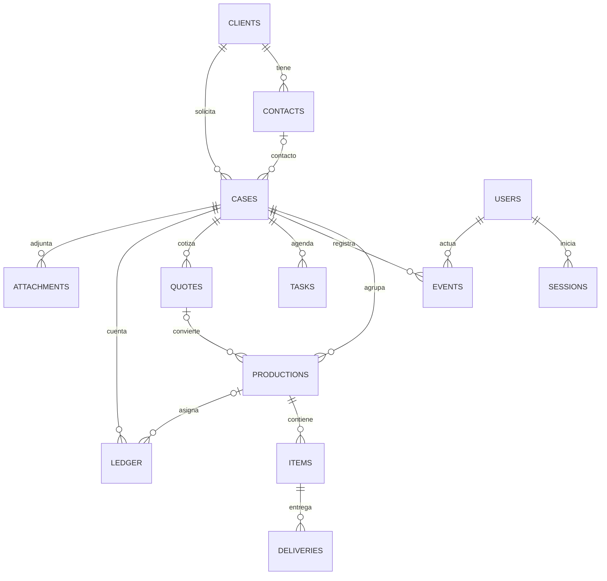

# Base de datos, relaciones y migraciones

**Dirigido a:** desarrolladores y administradores. **Resuelve:** dónde viven los datos y cómo cambiar o recuperar el esquema.
**Requisitos:** SQL básico y acceso a una base aislada; para producción, respaldo verificado y ventana de mantenimiento.
**Revisión:** 2026-11-15 · producto 1.5.0 · fuente: `backend/app/models.py` y `backend/migrations/versions/`.

## Motor y conexión

El backend usa SQLAlchemy 2, PyMySQL y MySQL/InnoDB. La URL se construye en `backend/app/config.py` con `MYSQL_DATABASE`, `MYSQL_USER`, `MYSQL_PASSWORD`, `DB_HOST` y `DB_PORT`; nunca la imprimas en logs ni en diagnósticos. `backend/app/db.py` configura `READ COMMITTED`, `pool_pre_ping` y límites de pool configurables.

Los perfiles del repositorio fijan versiones distintas dentro de MySQL 8.4: `compose.yaml` usa `mysql:8.4.11`; `compose.low-resource.yaml` construye MySQL `8.4.13-1debian12`. Esto describe los archivos, no la versión que corre hoy en el servidor físico.

## Mapa de relaciones



Las relaciones del diagrama son las claves foráneas declaradas en los modelos; varias referencias de auditoría o compatibilidad histórica no aparecen aquí. En particular, la solicitud (`cases`) es el expediente estable y una solicitud puede tener varias OP (`productions`). Cada partida (`items`) pertenece a una solicitud y a una OP. Entregas se registran por partida; movimientos financieros conservan el vínculo a solicitud y, cuando está disponible, a la OP. No se duplican clientes al crear varias OP.

## Tablas por responsabilidad

| Área | Tablas | Uso y notas |
|---|---|---|
| Identidad y acceso | `users`, `roles`, `sessions`, `login_attempts` | Cuentas, permisos, sesiones y control de intentos. La base guarda el hash del token de sesión, no el token de navegador. |
| Clientes y expediente | `clients`, `contacts`, `cases`, `events`, `tasks` | Perfil, contactos, solicitud central, bitácora y tareas/seguimientos. `cases.related_case_id` enlaza expedientes relacionados. |
| Cotización y producción | `quotes`, `productions`, `items`, `partial_release_requests` | Versiones de cotización, OP, partidas y aprobaciones de liberación parcial. Una aprobación de cotización puede enlazarse a una OP; el snapshot preserva datos de producción históricos. |
| Entrega y dinero | `deliveries`, `ledger` | Entregas por cantidad y movimientos monetarios. Un movimiento corregido se conserva y se enlaza mediante `ledger.reverses_id`; no se elimina para ajustar el saldo. |
| Reintentos y preferencias | `idempotency`, `creation_requests`, `drafts`, `saved_views` | Evitan duplicados de mutaciones/altas y almacenan borradores y vistas por usuario. Las claves de creación son únicas por usuario. |
| Archivos y borrado | `attachments`, `deletion_audit`, `file_cleanup` | Metadatos y huellas; los bytes se guardan bajo `UPLOAD_DIR`. El borrado definitivo deja auditoría y una cola reintentable para retirar archivos después del commit. |
| Compatibilidad histórica | `provider_inbox`, `mail_accounts`, `mail_sync_cursors`, `mail_worker_tasks`, `mail_sync_outcomes`, `mail_messages`, `mail_attachments` | Estructuras que aún aparecen en modelos/migraciones para compatibilidad e historial. Su presencia no significa que correo o canales externos estén activos; consulta [Retirada de mensajería](RETIRADA_MENSAJERIA.md). |

`deletion_audit.actor_id` conserva el identificador del actor sin FK para que el registro de auditoría sobreviva al borrado de la cuenta relacionada. No interpretes todas las columnas legadas como flujo activo: algunas se mantienen para leer y conservar registros anteriores.

## Índices y restricciones

Los modelos declaran índices para búsquedas frecuentes por cliente/solicitud, responsable, vencimiento, estado de producción, entregas y bandejas. Entre los índices compuestos visibles están `ix_case_pool`, `ix_case_lifecycle_owner`, `ix_task_due_open_case`, `ix_task_category_open_case`, `ix_ledger_due_case`, `ix_delivery_case_item` e `ix_production_active_stage`. Hay además unicidad para versiones de cotización, claves idempotentes, claves de creación por usuario, una reversión por movimiento, claves QR y otros registros de integración.

Antes de cambiar o añadir un índice, revisa `EXPLAIN`, el orden/selección de columnas, el costo de escritura y el tamaño de la base real. No se ejecutó un plan de consulta del servidor físico en esta auditoría.

## Migraciones

Alembic parte de `58d1e221e63e_initial_schema` y continúa con las revisiones numeradas hasta `018_optional_payment_due_date`. El arranque `python -m app.start` ejecuta `alembic upgrade head` antes de abrir Uvicorn.

Desde `backend/`, en una base aislada:

```sh
../.venv/bin/python -m alembic current
../.venv/bin/python -m alembic check
../.venv/bin/python -m alembic revision -m "descripcion"
```

Revisa el archivo de migración generado, prueba `upgrade head` con un esquema `_test`, comprueba datos y compatibilidad, y conserva la revisión aplicada. No edites revisiones publicadas ni ejecutes `downgrade` en producción como reparación automática. Una migración no sustituye un respaldo.

## Respaldo y restauración

Los comandos del perfil beta, copia de adjuntos, validación y restauración están en [Operación: respaldo y recuperación](OPERACION.md#respaldo-y-recuperacion). La base y los archivos (`UPLOAD_DIR`) forman una sola unidad de recuperación: respalda ambos en una ventana consistente. Valida que el archivo no esté vacío, verifica integridad y restaura primero en una instancia aislada. El sufijo `_test` es necesario, pero por sí solo no demuestra que una base sea desechable: no ejecutes las pruebas de integración sobre una copia operativa ni una instalación anterior hasta comprobar que la base, los datos persistentes y el proyecto Compose están aislados.
